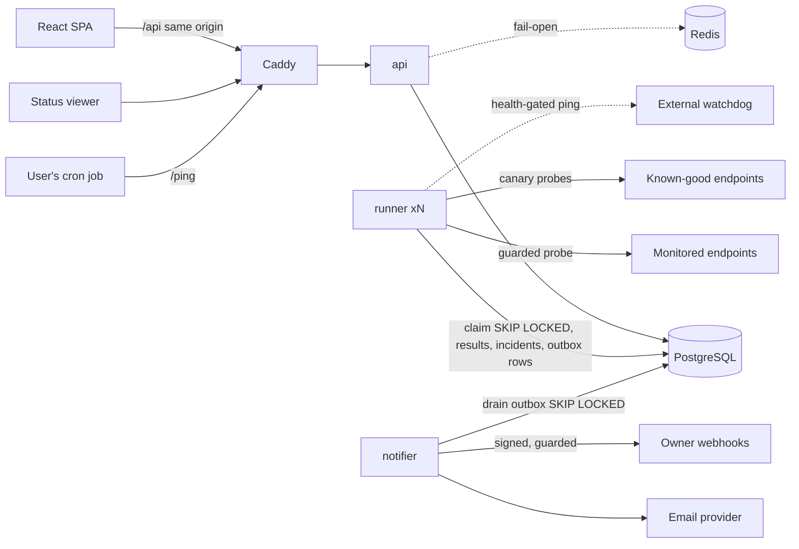
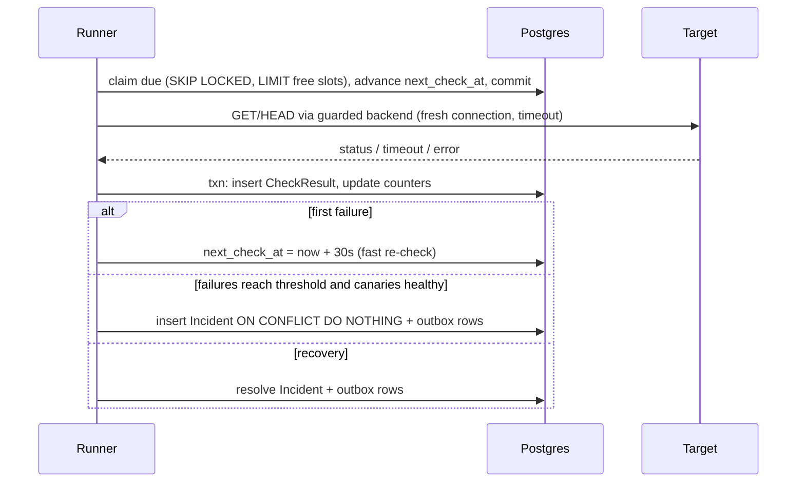
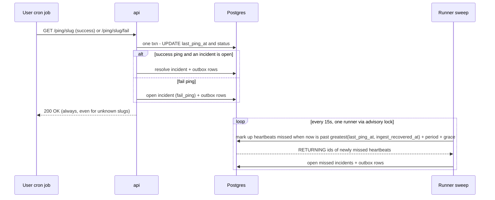

# Cronos SRS — Uptime & Cron Monitoring

Oct 3, 2026 · @Oryn Bonya

Cronos is Project 2 of the 100-day plan: it checks endpoints on a schedule, catches dead cron jobs through heartbeat pings, raises trustworthy incidents, alerts by email and webhook, and publishes status pages. Stack: FastAPI, Postgres-backed runner processes, and a React SPA with a motion-rich design system. Revision 2 folds in the design review: merged runners, a transactional outbox, connect-time SSRF guarding, heartbeat self-outage suppression, cached status pages, a testing harness, and a full UI spec. Timeline: days 1–15.

## 1. Overview

Cronos is lightweight monitoring for small projects: it polls HTTP endpoints and alerts when they go down, and it catches dead scheduled jobs via heartbeat URLs (a cron job pings a URL when it finishes; Cronos alerts if the ping does not arrive in time). It also publishes status pages. The defining constraint: a monitor must be more reliable than the things it watches, and must never blame a user's service for its own failure.

**In scope (v1)**

- Owner accounts with sessions and API keys (Project 1 foundation pattern, re-implemented in FastAPI).
- HTTP(S) uptime monitors: URL, GET or HEAD, expected status (default any 2xx), interval, timeout.
- Heartbeat monitors: period plus grace, a public ping URL, and an explicit `/fail` signal.
- Runner processes that claim due checks from Postgres, probe safely, and sweep for missed heartbeats.
- Incident detection with a fast confirmation re-check, flap handling, and acknowledgement.
- Alerts by email and signed webhook, delivered through a transactional outbox with retries.
- Public and private status pages served from cached snapshots.
- A motion-rich React dashboard with a floating bottom navbar (section 9).
- Advisory latency anomaly flags.
- One generous launch plan for everyone, with clearly communicated limits and metering; billing, tiers and feature gating arrive in v2.

**Out of scope (v1)**

- SMS/phone paging, Slack, PagerDuty (payment seam; Slack first).
- Multi-region checking (single region; `region` column reserved).
- POST/PUT monitors, custom headers, keyword/content assertions, TCP checks.
- Cron-expression heartbeat schedules (first v2 item), `/start` duration tracking.
- Teams, on-call schedules, custom status-page domains, billing and paid tiers (v2).

**Goals**

- Alert on a real outage within one check interval plus about 30 seconds of confirmation.
- Never open an incident caused by Cronos's own network or downtime when that can be detected (canaries, self-outage suppression).
- Detect Cronos's own failure from outside the box (health-gated external watchdog).
- A UI that feels live and futuristic without hurting speed or accessibility.

**Non-goals**

- Competing with incident-management suites.
- Sub-minute checks or enterprise SLAs.

## 2. Users and stakeholders

- **Developer / operator (primary user, has an account).** Runs small services or scheduled jobs and wants to know before their users do that something broke. Creates monitors and heartbeats, wires the heartbeat URL into their cron, configures where alerts go. Technical.
- **The monitored service (passive target).** The endpoint being polled, or the cron job doing the pinging. Not a user; the checker must treat it politely (reasonable intervals, timeouts, honouring that it may be someone else's infrastructure).
- **Status-page viewer (anonymous).** Someone checking whether a service is up via a public status page. No account; read-only.
- **Platform operator (you).** Runs the service, must keep the scheduler alive and honest, watches cost and the health of the checker itself. Uses the API/admin and an external safety net.

The defining tension is between the operator's need for *fast* alerts and the need for *trustworthy* ones: alert too eagerly and a network blip cries wolf; confirm too long and real outages are reported late. Section 7's confirmation policy is where that balance lives.

## 3. Tech stack and rationale

FastAPI's async model fits firing many outbound checks concurrently, and a decoupled React SPA gives a real API-plus-frontend architecture, different from Project 1's server rendering. Exact versions are pinned by Claude Code on day 1 to current stable releases.

| Layer | Choice | Rationale |
| --- | --- | --- |
| Language | Python 3.12 | Async checks and analytics in one language |
| API | FastAPI on Uvicorn | Async-first; auto OpenAPI |
| Check engine | `runner` processes (custom async loop) | Claim, probe and record in one process; scale by replicas (section 7) |
| Alert delivery | `notifier` process draining an outbox table | Slow webhooks never delay checks; no alert lost on crash |
| HTTP client | httpx with a custom httpcore network backend | SSRF validation at connect time; per-phase timings |
| Database | PostgreSQL 16 + asyncpg | Source of truth and the clock; `SKIP LOCKED`, partial unique indexes |
| Redis | Redis 7, non-critical | Rate limits and caches only, all fail-open; nothing on the check or alert path |
| ORM / migrations | SQLAlchemy 2.0 async + Alembic | Explicit migrations |
| Passwords / sessions | argon2 (argon2-cffi), sessions in Postgres | Auth must not fail open, so not in Redis |
| Frontend | React + Vite + TypeScript + Tailwind | SPA dashboard and public status page |
| UI primitives | Radix-based components (shadcn/ui pattern) + lucide icons | Accessible behaviour; our own visual layer |
| Motion | Motion (formerly Framer Motion) | Shared-layout nav indicator, route and list transitions |
| Data fetching | TanStack Query + React Router | Polling, caching, optimistic updates |
| Charts | Recharts, custom-styled | Latency and uptime history |
| Analytics | Pure Python incremental EWMA; pandas in notebooks only | No heavy deps in the runner |
| Edge | Caddy | TLS, serves the SPA, proxies `/api` and `/ping` on one origin |
| Email | Postmark or Resend in prod; Mailpit locally | Transactional deliverability |
| Packaging | Docker Compose | Same artifact locally and on the VPS |

**Deployment note:** runners and the notifier are always-on loops, so Cronos lives on a persistent VPS (Hetzner), not a platform that sleeps idle processes.

## 4. System architecture

Three long-running process types share one Postgres: **api**, **runner** (any number of replicas) and **notifier**. Postgres is the only dependency on the check and alert path; Redis carries rate limits and caches and may fail without stopping checks or alerts. Caddy fronts everything on a single origin.



**Components**

- **api** — auth, CRUD, ping endpoints, public status snapshots. Upserts an `api_alive` row every 10s so runners can detect ingest outages.
- **runner** — claims due monitors up to its free capacity, probes them, records results, opens and resolves incidents, writes outbox rows. Also runs single-instance maintenance jobs under a Postgres advisory lock (heartbeat sweep, rollups, retention, snapshots).
- **notifier** — claims pending outbox rows, delivers email and webhooks with retries, records every attempt.
- **Postgres** — state, schedule and queue. **Redis** — fail-open rate limits and caches.

**HTTP check lifecycle**



**Heartbeat lifecycle**



The inversion is the point of heartbeats: for monitors Cronos acts and expects a response; for heartbeats it waits and alerts on *silence*.

## 5. Data model

UUID primary keys everywhere except the two high-volume tables (bigint). All timestamps are `timestamptz` and every time comparison uses Postgres `now()`, never the app clock. Integrity lives in the database: polymorphic references are two nullable foreign keys with a CHECK that exactly one is set.

**As built (day 2).** Physical tables use plural snake\_case names (`users`, `monitors`, `check_results`, …); the entity names below are logical. Every status and kind field is text with a CHECK constraint, never a Postgres enum type. Mutable configuration tables carry `updated_at`, maintained by a shared `set_updated_at()` trigger. The database and every connection are pinned to UTC. Cross-account links are impossible to insert: incidents, channel links, notifications and status-page items use composite `(account_id, x_id)` foreign keys. Cascades are database `ON DELETE` rules only; the models use no ORM relationships.

**Accounts and auth**

| Table | Key fields | Notes |
| --- | --- | --- |
| account | id, plan, created\_at | Owns plan and limits |
| user | id, account\_id, email (citext unique), password\_hash, email\_verified\_at | argon2 hashes |
| session | id = sha256(token), user\_id, expires\_at, last\_seen\_at, user\_agent | Cookie holds the raw token only |
| api\_key | id, account\_id, prefix, key\_hash, scopes\[\], last\_used\_at, revoked\_at | Shown once; looked up by prefix |
| auth\_token | id, user\_id, purpose, token\_hash unique, expires\_at, used\_at | Email verification and password reset; purpose is verify\_email or reset\_password; single use |

**Monitor** — an HTTP check.

| Field | Type | Notes |
| --- | --- | --- |
| id, account\_id, name | uuid, fk, text |  |
| url | text | http/https only; validated on save, enforced at connect |
| method | text | GET or HEAD |
| expected\_status | text | `2xx` (default) or an exact code |
| interval\_seconds | int | ≥ plan minimum |
| timeout\_seconds | int | default 10; must be < interval |
| confirm\_threshold | int | default 2 |
| next\_check\_at | timestamptz | partial index `WHERE is_active` |
| status | text | new / up / down / paused |
| consecutive\_failures | int | updated atomically |
| last\_checked\_at, status\_changed\_at | timestamptz | dashboard state |
| ewma\_mean, ewma\_var, ewma\_n, anomaly\_since | float, float, int, timestamptz null | section 8 |
| flapping\_since, muted\_until | timestamptz null | alert suppression |
| is\_active | bool | false when paused |

**Heartbeat** — a dead man's switch.

| Field | Type | Notes |
| --- | --- | --- |
| id, account\_id, name | uuid, fk, text |  |
| slug | text unique | `secrets.token_urlsafe(16)` (22 chars); a secret |
| period\_seconds, grace\_seconds | int |  |
| status | text | new / up / missed / failed / paused |
| last\_ping\_at, last\_ping\_kind | timestamptz null, text | success or fail |
| status\_changed\_at, flapping\_since, muted\_until | timestamptz |  |
| is\_active | bool |  |

**High-volume tables** (retention in section 7)

| Table | Fields | Notes |
| --- | --- | --- |
| check\_result | id bigint, monitor\_id, checked\_at, region, is\_up, status\_code, response\_time\_ms, timings jsonb, error, suppressed | Index (monitor\_id, checked\_at desc); `region` always `eu-1` in v1; `suppressed` = taken while canaries failed |
| heartbeat\_ping | id bigint, heartbeat\_id, received\_at, kind, ip\_hash, user\_agent (truncated) | Hashed IP, as Project 1 |

**Incidents and alerting**

| Table | Fields | Notes |
| --- | --- | --- |
| incident | id, account\_id, monitor\_id null, heartbeat\_id null, started\_at, confirmed\_at, resolved\_at, cause, last\_error, acknowledged\_at, acknowledged\_by | CHECK exactly one subject; partial unique index per subject `WHERE resolved_at IS NULL`; `started_at` = first failing check; `cause` is one of `http_status`, `timeout`, `connection`, `dns`, `tls`, `redirects`, `blocked` (monitors) or `heartbeat_missed`, `heartbeat_fail` (heartbeats), enforced to match the subject |
| notification\_channel | id, account\_id, kind, config jsonb, secret, verified\_at | email or webhook |
| monitor\_channel, heartbeat\_channel | subject id, channel\_id | FR-6.4 routing |
| notification (outbox) | id, account\_id, incident\_id null, channel\_id, event, payload jsonb, status, attempts, next\_attempt\_at, last\_error, created\_at, sent\_at | Index on (status, next\_attempt\_at); events: opened, resolved, fail\_ping, flapping, cap\_reached |

**Status pages**

| Table | Fields | Notes |
| --- | --- | --- |
| status\_page | id, account\_id, slug unique, title, is\_public, access\_token\_hash, snapshot jsonb, snapshot\_at, snapshot\_dirty | Public reads hit only `snapshot` |
| status\_page\_item | status\_page\_id, monitor\_id null, heartbeat\_id null, display\_name, position | CHECK exactly one; deleting a subject cascades the item |

**Aggregates, metering, system**

| Table | Fields | Notes |
| --- | --- | --- |
| latency\_hourly | monitor\_id, hour, checks, up\_checks, min\_ms, avg\_ms, p95\_ms, max\_ms | PK (monitor\_id, hour); charts read only this |
| usage\_event | account\_id, day, kind, quantity | Project 1 shape, written as daily rollups, never per check |
| api\_alive | instance\_id, last\_alive\_at | Ingest-outage detection |
| runner\_state | runner\_id, last\_tick\_at, in\_flight, lag\_seconds | Health gate for the watchdog |
| system\_state | key, value timestamptz | e.g. `ingest_recovered_at` |

## 6. Functional requirements

**Auth and accounts**

- FR-1.1 Register, verify email, log in/out, reset password.
- FR-1.2 Create, list and revoke scoped API keys; the key is shown once.
- FR-1.3 Settings page showing plan, limits and current usage.
- FR-1.4 Monitors and heartbeats do not run until the email is verified.

**Monitor management**

- FR-2.1 Create an HTTP monitor: name, URL, GET/HEAD, expected status, interval, timeout.
- FR-2.2 Reject private, loopback, link-local and metadata targets on save with a clear message.
- FR-2.3 Enforce the plan's minimum interval and maximum count.
- FR-2.4 List, edit, pause/resume, delete. "Check now" sets `next_check_at = now()`.

**Check execution**

- FR-3.1 Each active monitor runs at its interval, best-effort, with jitter.
- FR-3.2 Bounded concurrency per runner; each check has a hard timeout.
- FR-3.3 Each check writes a CheckResult with status, latency, phase timings or error.
- FR-3.4 A runner crash skips at most one interval per monitor and never double-checks within an interval.

**Heartbeats**

- FR-4.1 Create a heartbeat with period and grace; issue `/ping/{slug}` and `/ping/{slug}/fail`.
- FR-4.2 GET/POST/HEAD `/ping/{slug}` records success; `/fail` records an explicit failure and opens an incident immediately.
- FR-4.3 A new heartbeat stays `new` and never alerts until its first ping.
- FR-4.4 The sweep marks heartbeats missed after period + grace, measured from the later of the last ping and the last ingest recovery.
- FR-4.5 Any success ping resolves an open incident.

**Incidents**

- FR-5.1 First failure triggers a re-check after 30s; an incident opens at `confirm_threshold` consecutive failures.
- FR-5.2 No incident opens while the runner's canaries are failing.
- FR-5.3 Auto-resolve on recovery; record duration from the first failing check.
- FR-5.4 Acknowledge an incident; this silences flap notices until it resolves.
- FR-5.5 Incident history per subject and per account.

**Alerting**

- FR-6.1 Add and verify channels: email by link, webhook by a test POST returning 2xx.
- FR-6.2 Alert on open, resolve and fail ping.
- FR-6.3 Three or more incidents on one subject within 30 minutes enter flapping: one flapping notice, then silence until stable for 30 minutes.
- FR-6.4 Route each monitor and heartbeat to selected channels.
- FR-6.5 Enforce a daily alert cap per account by plan; send one cap-reached notice.
- FR-6.6 Show a delivery log per channel.

**Status pages**

- FR-7.1 Create a page with slug, title, ordered items and display names.
- FR-7.2 Public pages need no auth; private pages need an unguessable token.
- FR-7.3 Show current status, 90-day uptime bars, uptime % and recent incidents.

**Dashboard**

- FR-8.1 Overview of monitors and heartbeats with live status.
- FR-8.2 Latency and uptime charts over 24h, 7d and 30d.
- FR-8.3 Advisory anomaly badges.
- FR-8.4 Command palette (Cmd/Ctrl+K) for navigation and actions.

**Plans and metering**

- FR-9.1 Enforce limits from `PLANS`.
- FR-9.2 Daily usage rollups shown against limits.
- FR-9.3 Show the launch-period notice at signup, in Settings and on a /pricing page (section 12).

## 7. The check engine

The engine's guarantee is narrow and stated honestly: a crash may skip one interval per monitor, never duplicates a check within an interval, never loses an alert, and never blames a user for Cronos's own outage when that can be detected.

**Runner loop: database as the clock.** Each runner ticks every 2s. It claims only as many monitors as it has free semaphore slots, so other runners take the rest. The claim and the schedule advance are one short transaction; no lock is held during HTTP.

```sql
WITH due AS (
  SELECT id FROM monitor
  WHERE is_active AND next_check_at <= now()
  ORDER BY next_check_at
  FOR UPDATE SKIP LOCKED
  LIMIT :free_slots
)
UPDATE monitor m SET next_check_at = CASE
    WHEN m.next_check_at + make_interval(secs => m.interval_seconds) > now()
      THEN m.next_check_at + make_interval(secs => m.interval_seconds)  -- keep cadence
    ELSE now() + make_interval(secs => m.interval_seconds)            -- skip missed slots
  END
FROM due WHERE m.id = due.id
RETURNING m.*;
```

The advanced `next_check_at` acts as a lease. New and resumed monitors start at `now() + random(0, interval)` so creation bursts spread out. "Check now" sets `next_check_at = now()` and reuses this path. Each tick writes `runner_state` (last tick, in-flight count, oldest due lag).

**The probe.** httpx with a custom httpcore network backend: `connect_tcp` resolves the host, validates every address (section 13), and connects to a validated IP; TLS then layers on with the original hostname, so SNI and certificate checks stay correct and redirects are guarded automatically. Rules: a fresh connection per check (no pooling, which would hide connection failures), `trust_env=False`, max 3 redirects, read at most 64 KB of body then discard, honest `User-Agent: Cronos/1.0 (+https://<domain>/bot)`. Phase timings (DNS, connect, TLS, first byte, total) are recorded. Results for monitors paused or deleted mid-flight are discarded.

**Confirmation and incidents.** One transaction per result:

1. Insert the CheckResult.
2. On failure: `UPDATE ... SET consecutive_failures = consecutive_failures + 1 RETURNING` it. If it is 1, set `next_check_at = now() + 30s`. If it reaches `confirm_threshold`, insert the incident `ON CONFLICT DO NOTHING` (the partial unique index makes a duplicate impossible), with `started_at` = time of the first failing check, plus outbox rows.
3. On success: reset the counter; resolve any open incident with `RETURNING`; write resolve outbox rows only if a row was returned.

**Checker self-health (canaries).** Each runner probes 3 known-good endpoints every 30s. If 2 or more fail, the runner is degraded: results are stored with `suppressed = true`, failure counters do not move, no incidents open, and the watchdog ping stops (section 14). Cronos then reports its own problem instead of blaming every target.

**Heartbeats.** The ping is one UPDATE plus, when it changes state, an incident resolve or open and outbox rows in the same transaction. The sweep runs every 15s under an advisory lock as a conditional update, so concurrent runners are harmless:

```sql
UPDATE heartbeat SET status = 'missed', status_changed_at = now()
WHERE is_active AND status = 'up'
  AND greatest(last_ping_at, :ingest_recovered_at)
      + make_interval(secs => period_seconds + grace_seconds) < now()
RETURNING id;
```

**Self-outage suppression.** If the newest `api_alive` row is older than 30s, ingest is down. When it recovers, `ingest_recovered_at = now()`. Deadlines are measured from the later of the last ping and that moment, so a job whose ping bounced off our outage gets a full period to ping again. Cost: a true miss during our outage is reported one period late. That is the right trade.

**Notifier and outbox.** Incidents and their notification rows commit together, so an alert cannot be lost between them. The notifier claims rows with `SKIP LOCKED` and delivers. Retries back off at 1m, 5m, 15m and 1h, then the row is marked failed. Every attempt is logged for FR-6.6.

**Flapping and caps.** State lives in Postgres, not Redis. Three incidents on one subject within 30 minutes set `flapping_since`; open and resolve alerts are replaced by one flapping notice, and normal alerting resumes after 30 stable minutes. The daily per-account cap (section 12) turns excess rows into `suppressed` plus one cap-reached notice.

**Maintenance jobs** (one runner at a time via `pg_try_advisory_lock`): heartbeat sweep (15s), status snapshots for dirty pages and every 60s, hourly latency rollup, daily retention and usage rollup.

**Politeness.** Plan minimum intervals, a global cap of 60 checks per minute per target host across all accounts, a single re-check rather than retry storms, and an identifiable User-Agent with an info page.

## 8. Analytics and anomaly detection

Anomaly flags are advisory in v1 — a dashboard badge, never an alert — until a backtest shows they are precise. This mirrors Project 1's shadow mode.

**Goal.** Flag a service that is degrading (latency drifting up) before it fails.

**Approach (v1).**

- Model `x = ln(response_time_ms)`, because latency is right-skewed and z-scores on raw milliseconds cry wolf.
- Update an exponentially weighted mean and variance on every successful check, in O(1), stored on the monitor row (`ewma_mean`, `ewma_var`, `ewma_n`). No pandas in the runner.
- No flags during warm-up (`ewma_n < 30`).
- Flag when z ≥ 3 for 3 consecutive checks; clear after 3 consecutive normal checks. Anomalous points update the baseline at a reduced weight so a slow drift cannot absorb itself.

```latex
\mu_t = \mu_{t-1} + \alpha (x_t - \mu_{t-1}), \quad \sigma^2_t = (1-\alpha)(\sigma^2_{t-1} + \alpha (x_t - \mu_{t-1})^2), \quad z_t = \frac{x_t - \mu_{t-1}}{\sigma_{t-1}}
```

**Evaluation.** A notebook (pandas) replays stored check results and chaos-target scenarios — sudden 3x slowdown, slow drift, single spikes — and reports precision and recall for the flag. Tune α, the z threshold and the window there, not in production.

**v2.** Seasonal baselines (STL) once there are weeks of data; promoting the flag to a paid "performance alert" once the backtest earns it.

## 9. UI and experience design

Cronos should feel like a live instrument panel: first-class dark and light themes, glowing status colour, motion that explains state changes, and a floating bottom navbar as its signature. It draws on the visual language of [bonyaransom.me](https://www.bonyaransom.me/), so Cronos reads as part of the same body of work.

**Design source.** Only the portfolio's structure could be read from here, not its colours or fonts. On day 1, Claude Code uses Playwright to screenshot the portfolio (desktop and mobile, light and dark if offered) and extract computed styles — font families, type scale, palette, radii, shadows, blur, transition timings — into `frontend/design/tokens.md` for Oryn to approve. Motifs to carry over:

- Oversized display headings ending in a full stop: "Monitors.", "Incidents.", "Heartbeats."
- A small eyebrow line above each heading: "Live checks", "What broke", "Dead man's switches".
- Pill badges with a status dot, as in "Open to Work" — here "All systems up", "2 down", "Degraded".
- Chip rows and animated progress bars, reused as uptime and plan-usage bars.

**Identity (from the day 1 extraction).** Syne for display headings, Outfit for interface text, DM Mono for body copy and every number (tabular figures), 2px corners on surfaces, cards and inputs, and one glow shadow recipe. Exact values live in `frontend/design/tokens.md`.

**Colour roles.**

- Green `#00C853` means up/healthy and doubles as Cronos's brand glow. It is used only for status and brand marks, never for buttons or links.
- A separate cool interactive accent, chosen on day 5, covers buttons, links, focus rings, selected states and the navbar's active pill, so nothing clickable reads as a status.
- Status set: up green, down red, degraded amber, paused grey. Each has a dot/glow variant and a text-safe variant.
- Status is never colour alone: it always pairs with an icon or label.

**Two themes.**

- Dark (the portfolio's look) and light are both first-class. The default follows the OS (`prefers-color-scheme`); a toggle in the Account menu and command palette overrides it, remembered per browser.
- Tokens are CSS variables with a dark set and a light set; components never use raw colour values.
- The light theme is Cronos's own design, since the portfolio has none. It keeps the same fonts, corners, motion and colour roles. Glows become tinted rings and soft shadows, and the glass navbar uses a light translucent surface.
- Status and accent colours have per-theme values. `#00C853` is too light for text on white, so the light theme uses a darker green for text and keeps the bright green for dots and glows.
- An inline script in `index.html` applies the theme before first paint, so there is no flash of the wrong theme.
- Public status pages follow the viewer's OS theme.
- Screenshot checks cover both themes: 3 widths × 2 themes × reduced motion on and off.

**Floating bottom navbar (signature).**

- Fixed at `bottom: calc(1rem + env(safe-area-inset-bottom))`, centred, `width: fit-content`, `max-width: calc(100vw - 2rem)` — it hugs its items and never spans edge to edge.
- A rounded-full glass capsule: translucent surface, backdrop blur, 1px hairline border, soft shadow, generous padding (about 8px outer, 16px per item).
- Items: Overview, Monitors, Heartbeats, Incidents, Status pages, a divider, then Search (Cmd/Ctrl+K) and Account.
- The active item sits on a pill that slides between items as a Motion shared-layout animation.
- Incidents carries a live count badge that pulses while anything is open.
- On mobile, icons only; the active item expands to show its label.
- It shrinks slightly while scrolling down and restores on scroll up, but never hides.
- Pages reserve bottom padding equal to the bar's height plus 2rem so nothing sits under it.
- Accessibility: `nav` landmark, `aria-current`, visible focus rings, full keyboard reach.
- Not shown on public status pages, which get a tiny "Powered by Cronos" capsule instead.

**Motion system.** One shared set of tokens (durations 150/250/400ms, one spring, one ease), animating only `transform` and `opacity`.

- Route transitions: fade plus 8px rise with a light blur.
- Lists enter staggered; status changes morph colour; numbers count up.
- Skeleton shimmer on load, never spinners.
- Ambient layer: a slow animated grid or noise background with a faint radial glow.
- `prefers-reduced-motion` turns off all non-essential motion — the result must still look finished.

**Signature components.**

- Status orb: up glows green, down pulses red, degraded amber, paused grey.
- Heartbeat cards draw an ECG line that blips on each received ping and flatlines when missed.
- Monitor rows carry a live latency sparkline.
- The 90-day uptime bar strip has hover tooltips per day.
- Incident timeline: a vertical rail with animated segment fills.
- Command palette for navigation and actions.
- Toasts for actions; optimistic pause and resume.

**Liveness.** v1 polls with TanStack Query every 10s on visible pages, pausing in background tabs. Server-sent events are a stretch goal for day 12.

**Budgets.**

- The public status page is code-split from the dashboard: no chart library, under 100 KB gzipped JS, and a fast first paint on mobile.
- WCAG AA contrast in both themes.
- 60fps on a mid-range phone, with no layout shift from animations.
- Playwright screenshots of every page at three widths with reduced motion on and off, as in Project 1.

## 10. API and external interfaces

Everything is served from one origin behind Caddy: the SPA at `/`, the JSON API at `/api/v1`, pings at `/ping`. Session-cookie auth for the SPA, `Authorization: Bearer <api key>` for programmatic use. OpenAPI docs at `/api/docs`.

**REST API (`/api/v1`)**

- `POST /auth/signup|login|logout|verify|reset-request|reset`, `GET /auth/me`
- `GET/POST /api-keys`, `DELETE /api-keys/{id}`
- `GET/POST /monitors`, `GET/PATCH/DELETE /monitors/{id}`, `POST /monitors/{id}/check-now|pause|resume`
- `GET /monitors/{id}/results?range=24h|7d|30d` (from `latency_hourly`; last 24h may use raw rows)
- `GET/POST /heartbeats`, `GET/PATCH/DELETE /heartbeats/{id}`, `POST /heartbeats/{id}/pause|resume`, `GET /heartbeats/{id}/pings`
- `GET /incidents?subject=&state=`, `POST /incidents/{id}/ack`
- `GET/POST /channels`, `PATCH/DELETE /channels/{id}`, `POST /channels/{id}/verify|test`, `GET /channels/{id}/deliveries`
- `GET/POST /status-pages`, `GET/PATCH/DELETE /status-pages/{id}`, `POST /status-pages/{id}/rotate-token`
- `GET /overview` (one call for the dashboard), `GET /usage`

Errors use one shape: `{"error": {"code": "plan_limit", "message": "...", "field": "interval_seconds"}}`.

**Public ping endpoint.** `GET|POST|HEAD /ping/{slug}` and `/ping/{slug}/fail`. Outside `/api` so a one-line `curl` works. Always returns `200 OK` with a tiny body, including for unknown slugs, so slugs cannot be enumerated. Rate limited per slug (fail-open).

**Public status page.** The SPA route `/s/{slug}` (private: `/s/{slug}?t=<token>`) loads `GET /api/v1/public/status/{slug}`, which returns the stored snapshot with `Cache-Control: public, max-age=30`. Rate limited per IP.

**Outbound webhooks.** `POST` JSON `{event, incident, subject, occurred_at}` with headers `X-Cronos-Timestamp` and `X-Cronos-Signature: v1=<hex HMAC-SHA256(secret, timestamp + "." + body)>`. Receivers should reject timestamps older than 5 minutes. 5s timeout, no redirects, SSRF-guarded, retried per section 7.

**Health.** `/healthz` (process alive) and `/readyz` (DB reachable, a runner ticked within 30s, outbox oldest pending under 5 minutes).

## 11. Non-functional requirements

- **NFR-1 Self-reliability (headline).** The check and alert path depends only on Postgres. A runner crash skips at most one interval per monitor and never duplicates a check within an interval; the outbox means no alert is lost. Total failure is caught by the external watchdog (section 14).
- **NFR-2 Alert trustworthiness.** No incident from a single failed probe, from a degraded checker (canaries), or from a heartbeat whose ping bounced off a Cronos outage. Residual risk: a regional network fault canaries miss; multi-region is the v2 fix.
- **NFR-3 Alert latency.** Monitor outage to alert queued: ≤ interval + 30s + 5s typical. Heartbeat miss: ≤ 15s after period + grace. Outbox to delivery: under 10s median.
- **NFR-4 Scheduling accuracy.** p95 start lag under 5s at normal load; intervals are best-effort and stated as such in the UI.
- **NFR-5 Scalability.** Runners and notifiers scale by replicas with no coordination; one small VPS runs thousands of 5-minute monitors.
- **NFR-6 Security.** Connect-time SSRF guard on monitors and webhooks; sessions and scoped API keys; CSRF protection; signed webhooks; secrets in env (section 13).
- **NFR-7 Data retention.** Raw results and pings kept per plan, then deleted in batches; hourly aggregates kept longer.
- **NFR-8 Politeness.** Plan minimum intervals, a 60 checks per minute per host global cap, an identifiable User-Agent, no retry storms.
- **NFR-9 Availability.** 99.5% target for API and dashboard. A worker outage delays checks; it never loses them.
- **NFR-10 Observability.** Structured JSON logs, Sentry with scrubbing, and internal metrics: time since last tick, start lag, in-flight checks, outbox depth and age, canary state.
- **NFR-11 Cost.** Anonymous traffic (pings, status views) costs one indexed write or one cached read, never fan-out; free-tier email volume is capped per account.
- **NFR-12 UI quality.** Motion at 60fps on mid-range phones, `prefers-reduced-motion` honoured, WCAG AA, status page under 100 KB JS (section 9).

## 12. Plans, payment seams and metering

v1 launches with one plan, `launch`, for every account: no billing, no tiers, no feature restrictions. Limits at launch exist only to protect cost and prevent abuse. Users are told plainly, at signup and in Settings, that these are launch limits and that when Cronos monetises they will either choose a paid plan or move to the free tier.

**The seam stays from day one.** A `PLANS` config, feature flags and usage metering, exactly as in Project 1. Every limit is read through the `check_limit()` dependency, never hard-coded, so v2 adds plans and billing without touching the engine.

| Limit | launch (v1, everyone) | free (v2, indicative) | pro (v2, indicative) |
| --- | --- | --- | --- |
| max\_monitors | 15 | 5 | 50 |
| max\_heartbeats | 15 | 5 | 50 |
| min\_interval\_seconds | 120 | 300 | 60 |
| channels\_allowed | email, webhook | email, webhook | + Slack, SMS |
| max\_status\_pages / private pages | 3 / yes | 1 / no | 5 / yes |
| raw\_retention\_days | 14 | 7 | 30 |
| aggregate\_retention\_days | 90 | 30 | 365 |
| alert\_emails\_per\_day | 50 | 30 | 500 |
| webhooks\_per\_day | 500 | 200 | 5,000 |

The two v2 columns are planning notes only and are not built in v1. Launch values are tunable in config.

**Transparency (v1).**

- Signup page and a dismissible Settings banner state: "Cronos is in its launch period. Limits are generous for now; when paid plans arrive you'll choose a plan or move to the free tier, with at least 30 days' notice."
- The same terms appear on a short `/pricing` page that lists the launch limits and says paid plans are coming.
- `account.plan = "launch"` and `account.created_at` are stored, so v2 can identify launch-era accounts (e.g. for a discount) without a promise of permanent limits.

**Transition to v2 (planned, not built).**

1. Email every launch account at least 30 days before limits change, with their current usage against the free tier.
2. On the switch date, accounts that have not upgraded move to `free` via the downgrade rule below.
3. Raw results beyond the new retention window are trimmed by the normal retention job after the switch.

**Downgrade rule.** Nothing is deleted. Monitors and heartbeats above the limit are paused, newest first, with a banner explaining why; intervals below the minimum are raised to it; private status pages become unpublished until upgraded.

**Metering.** `usage_event` rows are written by the daily rollup (checks run, pings received, alerts sent per account), never per check. In v1 they inform pricing; in v2 they also enforce.

## 13. Security and abuse

Cronos makes outbound requests to URLs users supply, for monitors and webhooks alike. That is a textbook Server-Side Request Forgery (SSRF) surface, and the guard must be in place before any real user adds a monitor.

**SSRF guard (both monitors and webhooks).**

- Enforced inside the custom httpcore network backend at connect time, so it covers every connection, every redirect hop and DNS rebinding. Save-time validation is UX only.
- Resolve all A/AAAA records; reject the request if any address is not globally routable (`ipaddress` `is_global` false). Unwrap IPv4-mapped IPv6 first. Explicitly deny 169.254.169.254, 100.64.0.0/10, 0.0.0.0/8, and Docker and Hetzner private ranges.
- http/https only; ports 80, 443 and 1024–65535 except a denylist (e.g. 2375, 5432, 6379, 11211); max 3 redirects for monitors, none for webhooks; `trust_env=False`.
- Test suite: decimal and octal IP forms, IPv6 loopback, a DNS name resolving to 127.0.0.1, a 302 to the metadata address, and mixed public/private record sets.

**Network layer (defence in depth).** Postgres and Redis sit on an internal-only Docker network. A host firewall rule (DOCKER-USER chain) drops runner and notifier egress to 169.254.169.254 and private ranges.

**Abuse.**

- Monitors run only after email verification (FR-1.4).
- A global cap of 60 checks per minute per target host across all accounts stops many free accounts amplifying against one victim.
- GET/HEAD only, so Cronos cannot be turned into a form spammer.
- Daily alert caps per plan protect email cost.
- Pings: unguessable 22-character slugs, always-200 responses, per-slug rate limits, one indexed write each.

**Auth.**

- httpOnly, Secure, SameSite=Lax session cookies; the database stores only the token's SHA-256.
- CSRF: same origin plus a required `X-CSRF-Token` header (double-submit) on state-changing routes.
- argon2 password hashes; rate-limited login, signup and reset.
- API keys hashed, prefixed, scoped and revocable.

**Data.**

- Webhook secrets encrypted at rest with an app key from env.
- Response bodies never stored or logged.
- Ping IPs hashed as in Project 1.
- Private status-page tokens stored hashed and rotatable; snapshots contain only the page's items.
- Logs never contain ping slugs or session tokens.

## 14. Deployment and operations

Cronos runs on a Hetzner VPS with Docker Compose, because its runners and notifier are always-on loops. A real domain with SPF, DKIM and DMARC is a hard prerequisite for day 14: for a monitoring product, an alert in spam is an outage.

**Compose services**

| Service | Role | Scale |
| --- | --- | --- |
| caddy | TLS, SPA static files, proxy for `/api` and `/ping` | 1 |
| api | FastAPI on Uvicorn | 1–2 |
| runner | Claim, probe, incidents, maintenance jobs | 1+ (2 in prod for crash testing) |
| notifier | Outbox delivery | 1 |
| db | Postgres 16, internal network only | 1 |
| redis | Rate limits and caches, internal network only | 1 |
| mailpit, chaos | Local and test only | dev |

**Config.** 12-factor env: `DATABASE_URL`, `REDIS_URL`, `SECRET_KEY`, `ENCRYPTION_KEY`, `EMAIL_*`, `PUBLIC_ORIGIN`, `CANARY_URLS`, `WATCHDOG_URL`, `SENTRY_DSN`, Stripe keys (unused). Base images pinned by digest — a Project 1 lesson.

**Migrations.** Alembic runs as a one-shot service before api, runner and notifier start.

**Who watches the watcher (must-have).**

1. Health-gated watchdog: a runner pings Healthchecks.io every minute only if all of these hold — every runner ticked within 30s, start lag under 30s, oldest pending outbox row under 5 minutes, and canaries healthy. Healthchecks.io emails Oryn directly, bypassing Cronos's own notifier.
2. An independent uptime check on `/readyz` from a free external service.
3. Synthetic canaries inside Cronos: a monitor pointed at a deliberately failing endpoint and a heartbeat that is never pinged. Their alerts are checked end to end once a day; a missing alert trips the watchdog.

**Backups.** Nightly `pg_dump` to Cloudflare R2 with a tested restore script (reused from Project 1), plus retention keeping the database small.

**Observability.** JSON logs to stdout, Sentry, and metrics on `/readyz` for tick age, lag, outbox depth and canary state. The single most important alarm is time since last tick.

**Scaling.** Add runner replicas first, then notifiers; the API scales independently.

**Shared VPS caveat.** If Easyforms shares this host, Cronos monitoring Easyforms is a correlated-failure setup. That is acceptable for v1, because the external watchdog still catches a total outage.

## 15. Testing and verification

Every build day ends with live proof against the running Compose stack, not just a green test suite.

**Chaos target.** A tiny service in Compose that plays a misbehaving website. Its behaviour is switchable at runtime through `POST /_control`, per path:

| Mode | Behaviour |
| --- | --- |
| up / down | 200, or a chosen 4xx/5xx |
| slow | Delay N ms; supports a gradual ramp for anomaly tests |
| flap | Alternate up/down every N requests or seconds |
| hang | Accept the connection, never respond (timeout path) |
| redirect | 302 to a given URL, e.g. `http://169.254.169.254/` or `http://db:5432/` |
| big | Stream a 50 MB body |
| tls-bad | Self-signed or expired certificate on a second port |

The chaos target also hosts a fake webhook receiver that logs and verifies signatures and can return 500s, plus endpoints that resolve to private addresses for SSRF tests. Because it sits on a private Docker network, it is reachable only through a test-only allowlist flag that is never set in production.

**Automated tests.**

- pytest-asyncio against a real Postgres, never SQLite: `SKIP LOCKED`, partial indexes and `now()` semantics must be the real thing.
- An injectable clock for the confirmation, flap, sweep and suppression logic.
- A concurrency test: two runners on 200 due monitors produce exactly 200 results.
- Frontend: Vitest for logic; Playwright for flows and screenshots at 375, 768 and 1440px, with reduced motion both on and off.

**Live acceptance (examples).**

- `kill -9` a runner mid-batch: no duplicate results; the next tick resumes.
- Set the chaos target to flap: exactly one flapping email appears in Mailpit.
- Stop the api for 10 minutes while a 5-minute heartbeat is up: no missed alert after restart.
- Make the canaries fail: no incidents open, and `/readyz` reports degraded.

**Regression report.** As in Project 1, every Claude Code summary lists the test count before and after; any decrease must be explained.

## 16. Build order (days 1–15)

Fifteen days, one more than revision 1, to give the design system its own day. The engine comes before the features that depend on it, the SSRF guard lands with the first real probe, and rate limits ship with each public endpoint rather than at the end. Each feature day also ships its UI slice on the design system from day 5.

| Day | Focus | Live proof |
| --- | --- | --- |
| 1 | Compose skeleton (caddy, api, runner, notifier, db, redis, mailpit, chaos), app factory, async SQLAlchemy + Alembic, Vite/React/TS, logging, pytest harness, CLAUDE.md; Playwright extraction of portfolio tokens | `docker compose up`; SPA loads through Caddy; `/healthz` green; `tokens.md` ready for review |
| 2 | Full schema and migrations: all tables, partial unique indexes, CHECK constraints | Constraint tests fail correctly against real Postgres |
| 3 | Auth: argon2, Postgres sessions, CSRF, signup/verify/login/logout/reset, fail-open auth rate limits | Full flow via Mailpit; Redis down does not break login |
| 4 | API keys, `PLANS` + `check_limit`, monitor CRUD API with save-time URL checks | 16th monitor rejected (launch plan); private URL rejected |
| 5 | Design system and app shell: tokens, floating bottom navbar, motion system, route transitions, auth screens, monitor list and form | Playwright screenshots at 3 widths, reduced motion on and off |
| 6 | Runner: capacity-limited claims, cadence, jitter, check-now, `runner_state` (stub probe) | Two runners, no double checks; `kill -9` recovery |
| 7 | Probe: guarded network backend, fresh connections, caps, timings, CheckResult; SSRF test suite | Chaos redirect to metadata blocked; hang times out |
| 8 | Incidents: atomic counters, 30s re-check, confirmation, canaries, ack; incidents UI and timeline | A blip never pages; a real outage opens one incident |
| 9 | Notifier: outbox, email, signed webhooks, retries, verification, routing, flapping, caps; channels UI | Flap produces one notice; webhook 500 retried |
| 10 | Heartbeats: ping and fail endpoints, `new` state, sweep, ingest-outage suppression, slug rate limit; ECG cards | API down 10 min, no false miss |
| 11 | Status pages: snapshots, cached public endpoint, private tokens, uptime from incidents, light public bundle | Repeated views do not query per view; bundle under 100 KB |
| 12 | Rollups, latency and uptime charts, overview, command palette; SSE stretch | Charts read aggregates only |
| 13 | EWMA anomaly flag (advisory) and backtest notebook *(cuttable)* | Chaos slow ramp flagged; single spikes ignored |
| 14 | Hetzner deploy: real domain + SPF/DKIM/DMARC, Caddy TLS, egress firewall, watchdog, synthetic canaries, backups and restore test | Stopping runners on prod triggers the external alert |
| 15 | Retention and usage rollups, settings and usage page with launch notice, /pricing page, docs, polish, buffer | Production-ready v1 |

If a day slips, cut in this order: anomaly detection, SSE, private status pages. Never cut the SSRF guard, confirmation and canaries, the outbox, ingest-outage suppression, or the external watchdog.

## 17. Risks, decisions and open questions

**Risks**

| Risk | Mitigation |
| --- | --- |
| Total outage of Cronos | Health-gated external watchdog and independent `/readyz` check (section 14) |
| False alerts from our own network or downtime | 30s re-check, canaries, ingest-outage suppression; multi-region in v2 |
| SSRF | Connect-time guard on monitors and webhooks, network egress rules, dedicated test suite |
| Alert fatigue | Flapping state, acknowledgement, daily caps |
| Email in spam | Real domain with SPF/DKIM/DMARC before launch |
| check\_result growth | Plan retention, batched deletes, hourly aggregates for charts |
| Ambitious UI eats engine time | Design system is boxed into day 5; later days reuse it; animation polish is cuttable, engine guarantees are not |
| httpcore backend is fiddly | Prototype in plan mode on day 7 with the SSRF suite written first |

**Decisions (revision 2)**

| Question | Decision |
| --- | --- |
| Scheduler approach | Hand-rolled `SKIP LOCKED` loop; scheduler and workers merged into runners |
| Auth | Session cookies stored in Postgres, same origin, CSRF header; API keys for programmatic use |
| Free minimum interval | 5 minutes free, 1 minute paid |
| First paid channel | Slack (no per-message cost); SMS later |
| Regions | Single region for v1; `region` column reserved |
| Retention | Free: 7 days raw, 30 days hourly. Pro: 30 days raw, 365 days hourly |
| Alert delivery | Transactional outbox drained by a notifier process |
| Redis role | Non-critical; fail-open rate limits and caches only |
| UI direction | Portfolio-derived tokens; dark and light themes; green reserved for status with a separate interactive accent; floating bottom navbar; Motion |
| Monetisation | v1: one generous launch plan, no gating. v2: tiers and billing; users pay or move to free, with 30 days' notice |

**Open questions**

- Which domain, and bought when? It blocks day 14 email setup; Easyforms day 13b needs it too.
- Approve the extracted design tokens at the end of day 1 — and should Cronos match the portfolio palette exactly, or take its own accent within the same system?
- Email provider for production: Postmark or Resend.
- Do Easyforms and Cronos share one Hetzner VPS in v1?
